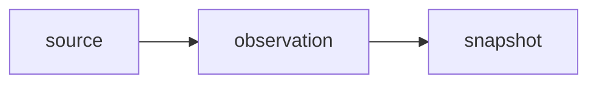

# Viewer fixture

A fixture document that passes every docs viewer lint rule.

Applies to v0.25.0 and main.

## Links

Read the [REST API](../../../docs/api/rest_api.md#authentication), the [CLI reference](../../../docs/developer/cli_reference.md), the [packages folder](../../../packages/) and the [core identity](../../../docs/foundation/core_identity.md). External: [npm](https://www.npmjs.com/package/neotoma). Same page: [code](#code-and-tables).

## Code and tables

```bash
neotoma setup --tool cursor --yes
```

```json
{ "entity_type": "task", "title": "Write the spec" }
```



| Field | Meaning | Example |
| --- | --- | --- |
| `entity_type` | The kind of record | `task` |
| `title` | A short name | `Write the spec` |

### A third-level heading

There is no telemetry. The CLI checks the npm registry for a newer version about once a day; the stdio MCP server checks when a session starts (off with `NO_UPDATE_NOTIFIER=1`), agents can also call the `npm_check_update` tool, which makes the same request, and the registry sees ordinary connection metadata such as the address.

- One
- Two
